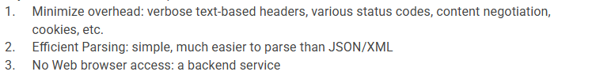
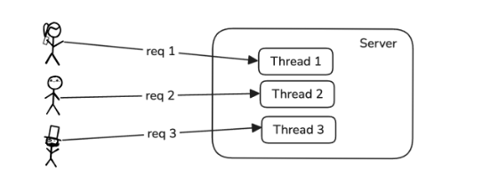
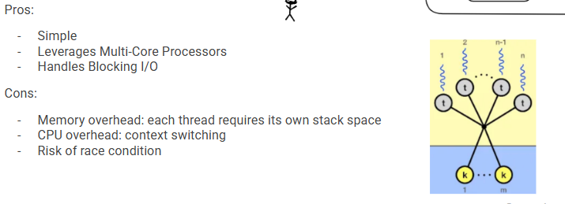
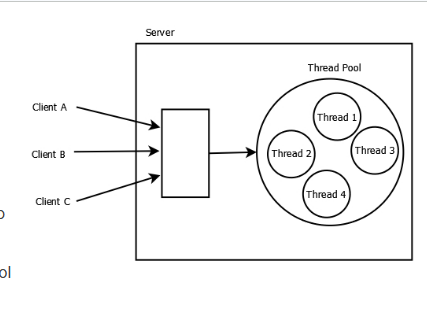
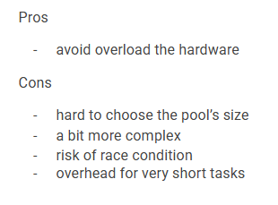
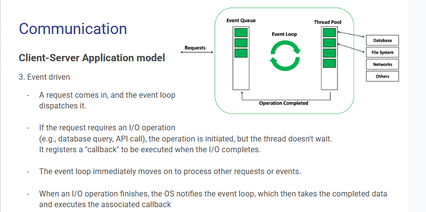
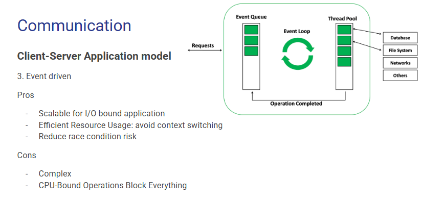

# 1. Redis Introduction:

- Redis(Remote Dictionary Server): open-source, in-memory, NoSQL key-value database.

- What is it used for: Caching, Session storage, Distributed lock,...

# 2. What's going on in a server?

- Hardware: CPU, Memory (RAM), I/O (mouse, keyboard, network, disk)
- Software: Applications
    1. Prorgam:
        - Executable file: .exe, .bin, .sh
        - A static entity
    2. Process:
        - An instance of a program in execution
        - Each process runs one program at a time
        - One program can have multiple processes
        - Act like a mini virtual server (CPU: time slicing of processor, RAM: address space)
    3. OS thread:
     - An object of activity within a process
     - Smallest sequence of programmed instructions that can be managed independently by a scheduler
     - managed by the OS
    4. User space thread:
        - threads managed by the user-level thread library
        - .e.g., JVM, goroutine,...
        - lightweight and faster than kernel thread

- Multi-threading programming:
    1. Pros:
        - Better resource utilization
        - Faster response time
        - Simpler program structure
    2. Cons:
        - More complex to implement
        - Harder to debug
        - race conditions
# 3. Communication:

How do serverts talk to each other?

There are a lot of protcols: HTTP, TCP, UDP,... But Redis uses its own protocol called RESP (REdis Serialization Protocol).

Why does Redis use RESP insread of HTTP?

Client-Server Application Model:

1. Thread-per-connection model: Each client connection is handled by a separate thread.

- When a thread performs a blockin I/O operation, that specific thread will pause until the operation completes.

- Where requests primarily involve heavy computation, allowing multiple threads to run in-parallel on multiple CPU cores.

2. Thread Pool:

A collection of pre-created threads that are used to execute tasks:

- whenever we want one, pick one from the pool. Once task is done, put it back to the pool.

3. Event Driven Model:

There is only one thread that handles all the requests. The thread uses an event loop to handle multiple connections.

For example, Reuqest 1,2,3 come in. They wait in the queue. And CPU handles R1 first. During the processing of R1, if it needs to do a blocking I/O operation, it will register an event (R1 now comes to thread pool for waiting I/O) and continue to process R2. When the I/O operation for R1 is done, it will be put back to the queue and wait for CPU to handle it.

