# 1. TCP Server:

A TCP server is a process that runs on a computer and is designed to listen for, accept, and manage incoming network connections from clients using TCP protocol.


A TCP server typically performs the following steps:

1. Passive listening for new connections at a port.

2. Accepting incoming connection requests from clients.
- Establish a dedicated communication channel ~ a socket.
- In general, a socket uses 4-tuple (server IP, server port, client IP, client port) to identify the connection.

3. Bidirectional:
All subsequent communication between the server and the client occurs over this socket. The server can send data to the client, and the client can send data back to the server.


## Thread Pool:

- We don't want to create a new thread for each client connection (1M connection <-> 1M threads for example). Instead, we can use a thread pool to manage a fixed number of threads that can handle multiple client connections concurrently.

- Here we will use goroutines not OS threads.


## How do we implement that thread pool?

We use a semaphore - a synchronization tool used in OS to manage access to shared resources in a multi-threaded environment.


!! Implementation will be in same folder.


# 2. Everything is a file:

**Unix/Linux philosophy: A file is a stream of bytes**

Everything: file, directory, sockert, device file,...

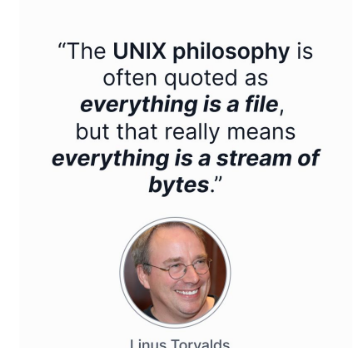

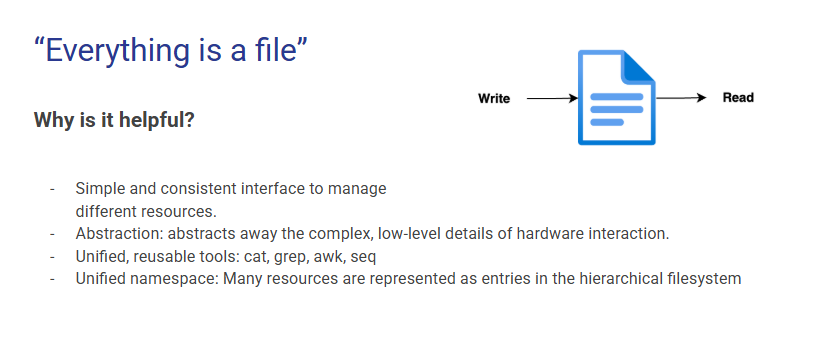

## File descriptor:

An integer identifies an open file of a process:

- local to process, each has process as its own table of File descriptors (FD table)
- act like an interface for process to read, write, close a file

Example:
```
fd = create("hello.txt", 777)
write(fd, "Hi", 2)
```

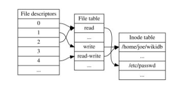


## Some previous confusion:

Previously I thought every file that I write to must appear on disk. But now I understand that a file descriptor is just an interface to read/write data. For example, for a TCP socket, there is no actual file on disk - it exists only in the kernel. When you write to its fd, the data goes to the network card and is sent to the client, not to disk.


# 3. I/O Models:

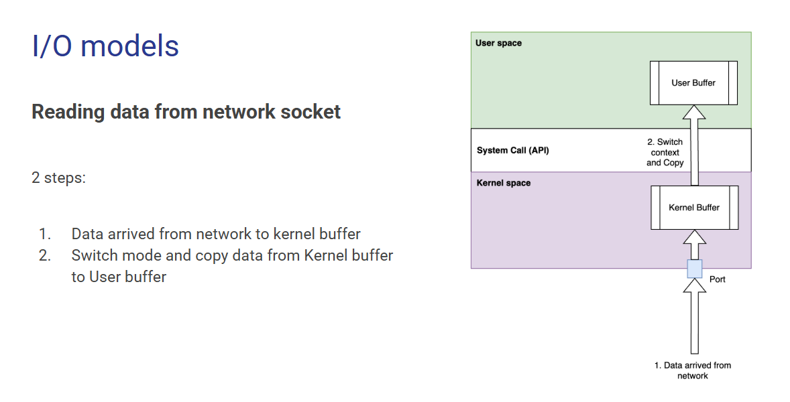

1. Blocking I/O:

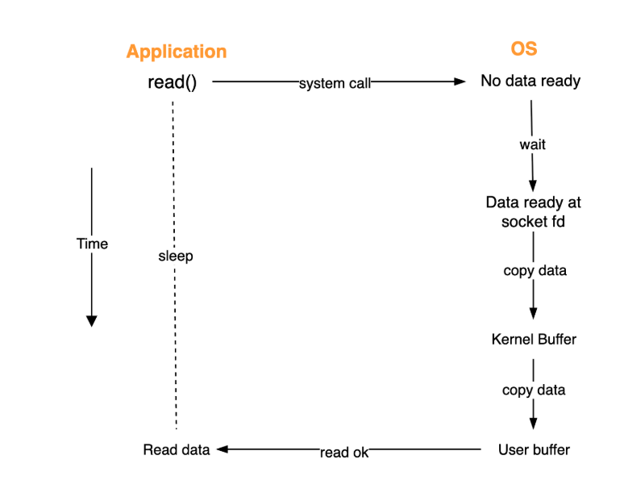

2. Non-blocking I/O:

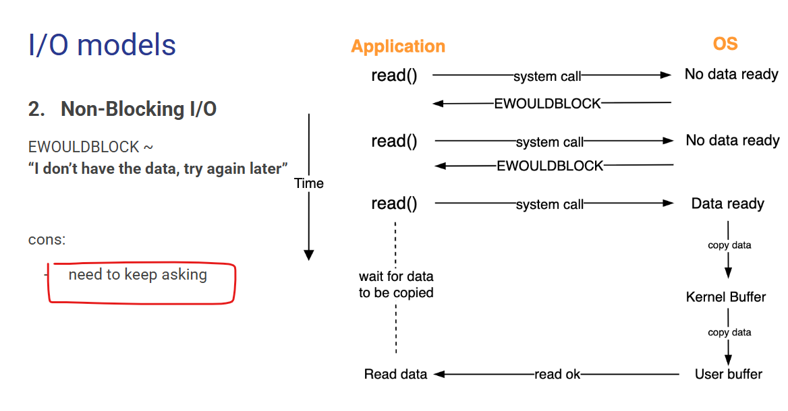

3. Asynchronous I/O:

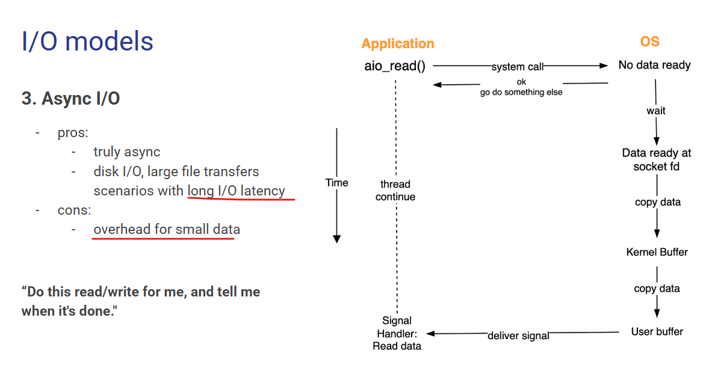

- Copy data to user buffer when thread is doing something else can be dangerous
- At beginning, need to reserve memory for user buffer, but we don't know how much data will be sent from client. So may be we need to reserve a large enough buffer, which can be wasteful.

!! Asynchronous I/O is more of a technique, not truly an I/O model. It is a way to handle I/O operations without blocking the main thread, allowing for better concurrency and responsiveness in applications.

4. I/O Multiplexing:

Idea: use 1 thread to handle multiple connections cocurrently without getting blocked.

Good for: Network servers (many cocurrent, small I/O events)

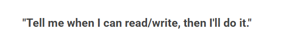

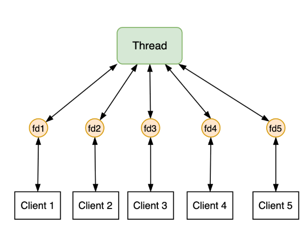

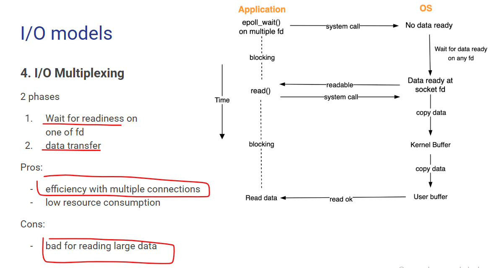

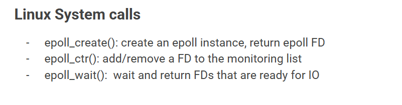

Workflow example:


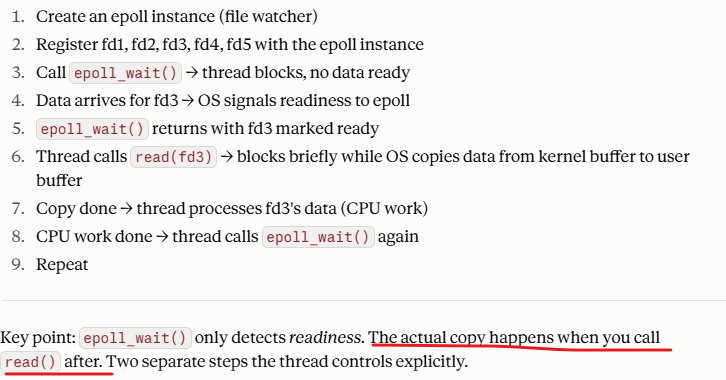

