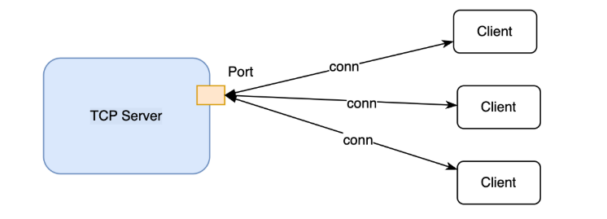
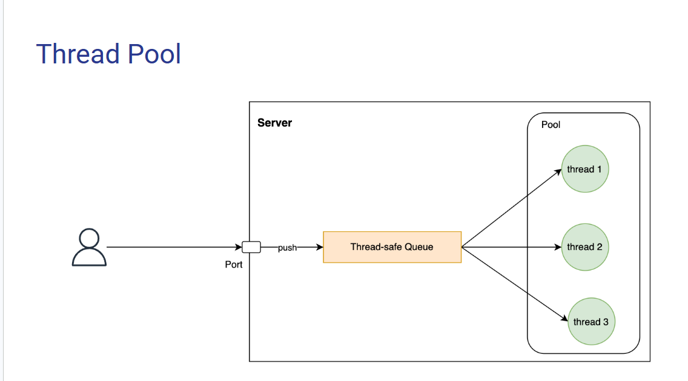
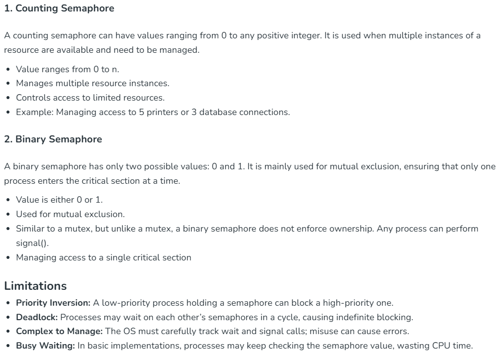

# 1. TCP Server:

A TCP server is a process that runs on a computer and is designed to listen for, accept, and manage incoming network connections from clients using TCP protocol.

A TCP server typically performs the following steps:

1. Passive listening for new connections at a port.

2. Accepting incoming connection requests from clients.
- Establish a dedicated communication channel ~ a socket.
- In general, a socket uses 4-tuple (server IP, server port, client IP, client port) to identify the connection.

3. Bidirectional:
All subsequent communication between the server and the client occurs over this socket. The server can send data to the client, and the client can send data back to the server.

## Thread Pool:

- We don't want to create a new thread for each client connection (1M connection <-> 1M threads for example). Instead, we can use a thread pool to manage a fixed number of threads that can handle multiple client connections concurrently.

- Here we will use goroutines not OS threads.

## How do we implement that thread pool?

We use a semaphore - a synchronization tool used in OS to manage access to shared resources in a multi-threaded environment.

!! Implementation will be in same folder.

