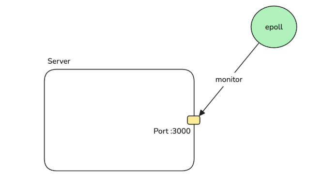
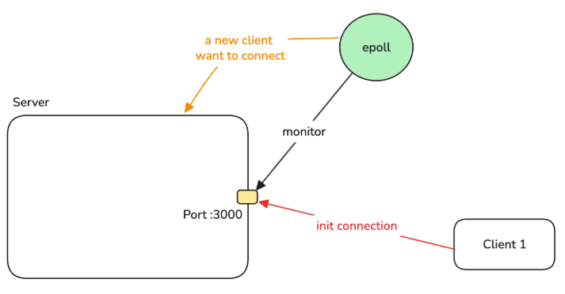
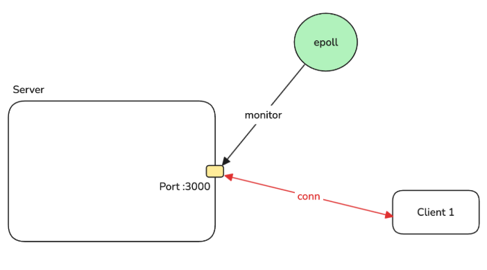
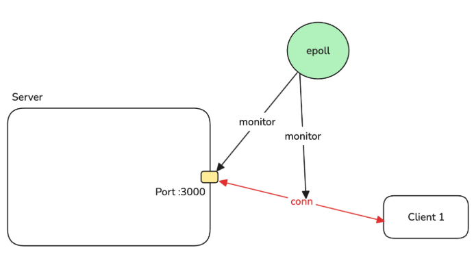
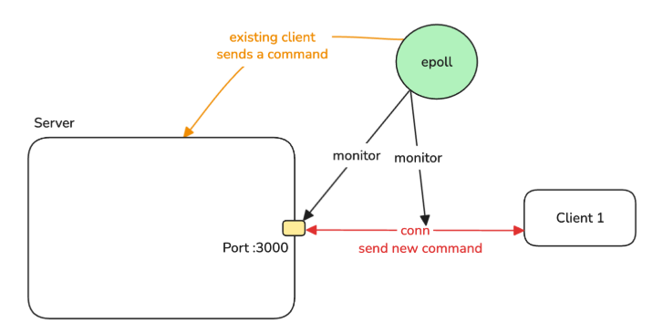
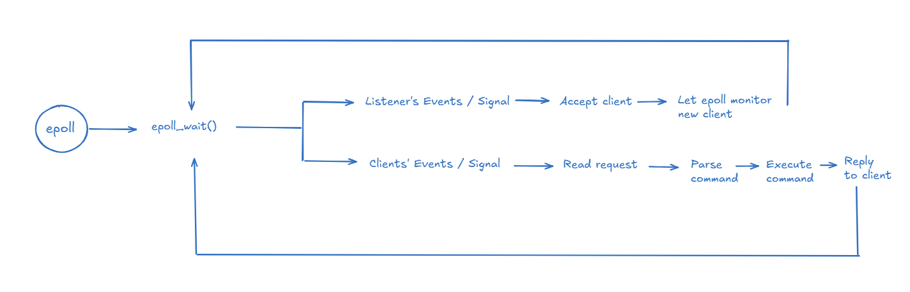
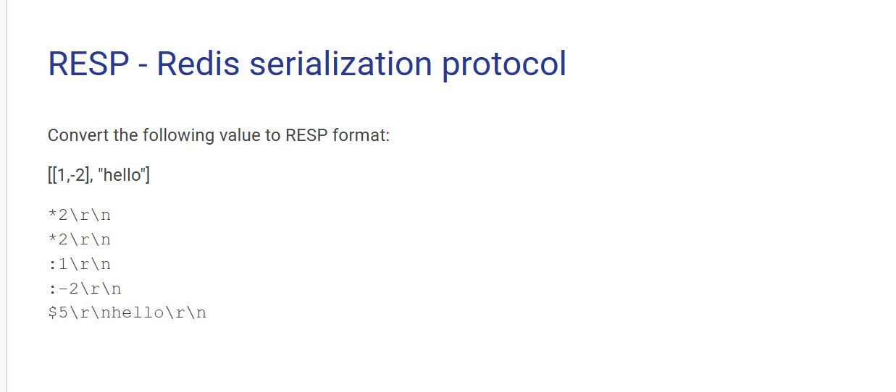

# 1 - Implement I/O Multiplexing

**Review concept:**

- Step 1: Create a Listener that listens to port 3000, then retreive its file descriptor (Why do we have to work with fd? Because later when we need the I/O multiplexer to monitor the fd, epoll/kqueue are OS-level syscalls — they work with file descriptors (integers). They don't know anything about Go's net.Listener, net.Conn, or any other high-level abstraction).

- Step 2: Create an epoll instance and let it monitor Listener's fd. (epoll is a Linux-specific I/O multiplexer, kqueue is the BSD/macOS equivalent).

- Step 3: There are two situation

1. A new client wants to make a TCP connection to server:
    - Epoll notifies server
    
    - Create a new connection
    
    - Let epoll monitor the new connection's fd
    
2. Existing client sends data to server:
    - Epoll notifies server
    
    - Read data from the connection, process command and response

# 2. RESP (Redis Serialization Protocol):

It's a protocol for Redis client to communicate with Redis server.

- Reliable (on top of TCP)
- Simple to implement
- Fast to parse
- Human-readable

Supports different data types: String, Error, Integer, Bulk String, Array...

1. **Simple String**:
- Starts with `+`
- Followed by a string and ends with `\r\n`
- Can't contain `\r\n` in the string

len(s) + 3 bytes (1 byte for `+`, 2 bytes for `\r\n`)

Example: `+OK\r\n`

2. **Bulk String**:
- Starts with `$`
- One or more decimal digits (representing the length of the string), in bytes, as an unsigned, base-10 value
- Followed by `\r\n`
- The string data
- Ends with `\r\n`

Example: `$6\r\nfoobar\r\n` (6 bytes of data, "foobar"), Null value -> `$-1\r\n`

3. **Integer**:
- Starts with `:`
- Followed by a signed decimal number in base 10
- Ends with `\r\n`

Example: `:1000\r\n` (the integer 1000)

4. **Array**:
- Starts with `*`
- Followed by a decimal number (the number of elements in the array)
- Followed by `\r\n`
- Followed by RESP types for each element in the array

Example: `*2\r\n$3\r\nfoo\r\n$3\r\nbar\r\n` (an array of 2 elements, "foo" and "bar"), Null value -> `*-1\r\n`

5. **Error**:
- Starts with `-`
- Followed by a string that describes the error
- Ends with `\r\n`

Example: `-Error message\r\n` (an error message)

