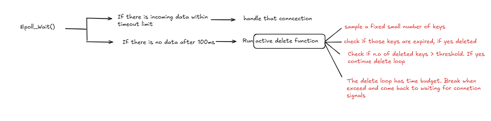

# 1. Refactor RESP and server code:

- **Recall that a command that client sends to server has the following format: it's an array of bulk strings. For example, the command `SET key value` is sent as an array of three bulk strings: `["SET", "key", "value"]`. The server should parse the incoming data according to this format and handle it appropriately.**

- Edge case handling on server: When client sends data, they can send many commands in one go, which can result in one command is not fully read. The server should somehow save the leftover data and read it in the next turn rather than discarding it.

Solution: whenever we face incomplete command (read resp.go to understand when InCompleteError happens), we should keep the leftover data in a buffer, and we have a map that each connection has its own buffer. When we read data from the connection, we first check if there is leftover data in the buffer, and if so, we prepend it to the new data before parsing.

--> So in this above example, we push the partial command "PING" into map[connection_1] buffer.

# 2: Implement commands (PING, GET, SET, ...):

In this part, I implemented **PING, GET, SET, TTL, PTTL, EXPIRE, DEL, EXISTS**; they are very straight forward. Just follow the official documentation for the correct behavior of each command.

## Worth mentioning point: How do we handle expired keys?

We can run a cronjob that periodically checks for expired keys and removes them from the database. However, this approach may not be efficient as it will require scanning the entire database to find expired keys, which can be time-consuming for large datasets -> CPU intensive.

So we have 2 mechanisms:

1. **Passive mode / Lazy delete**:
- We don't actively find which keys are expired. Instead, we check for expiration when a key is accessed (e.g., when a GET or SET command is issued). If the key is expired, we delete it and return an appropriate response to the client.

2. **Active mode**:

- We don't run this periodically like cronjob, instead we **only run this when the server is "not busy"**. In particular, we won't let the Epoll blocks forever on Wait() when there is no incoming signal, so we set a timeout for Wait() (e.g., 100ms). After that timeout, we can run the ActiveDelete() function

- Inside the Activedelete() function, we **randomly sample a fixed small number of keys (e.g., 20) from the map**, and check if they are expired. If they are expired, we delete them. **If the number of deleted keys >= our threshold (e.g., 25%), we can continue to sample and delete more keys**. Otherwise, we can stop the active deletion process and go back to waiting for incoming signals.

- However, **what if there are a lot of expired keys? And the delete loop happens many times**, which can cause latency for incoming requests. To avoid this, **we can set a time budget for the active deletion function**. After the time budget is exceeded, we can stop the active deletion process and go back to waiting for incoming signals.

