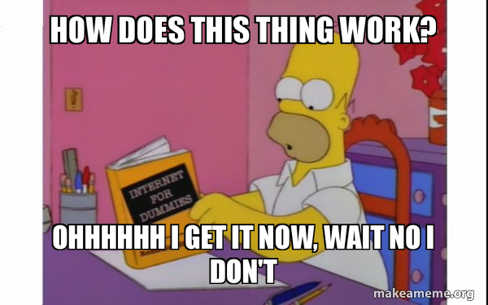
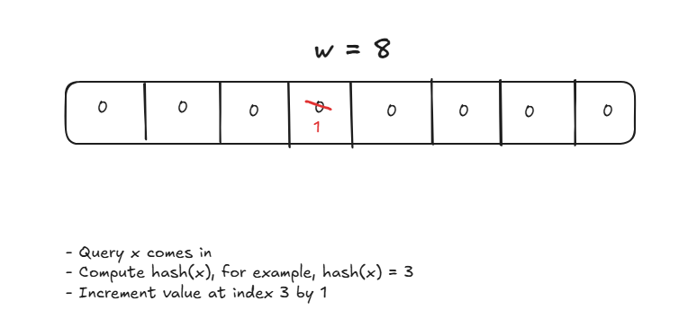
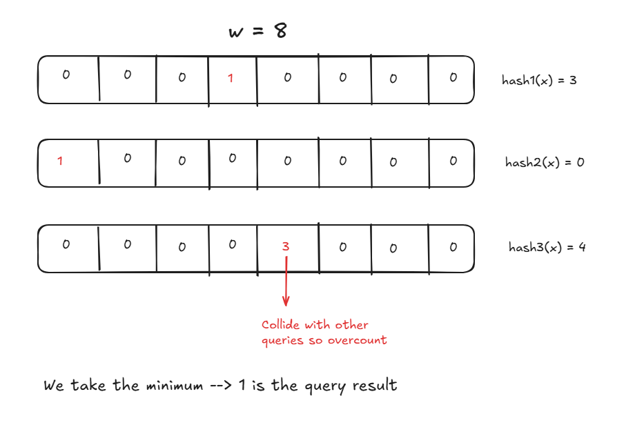
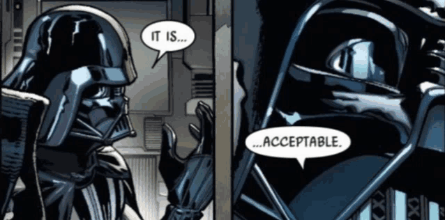
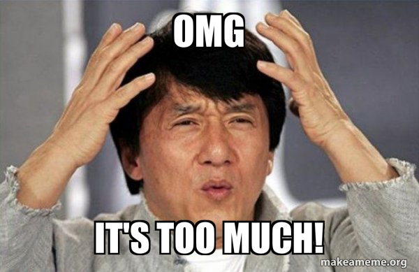
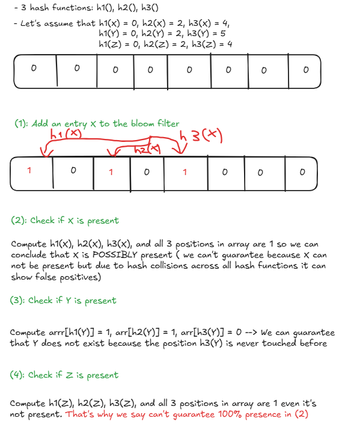

# 1. Count-min Sketch

## A) Problem Statement:

Imagine we are running a service that processes a stream of user search queries. We want to kepe track the frequency of each unique query. Given that:

- ~50 milion unique queries are expected per day
- Each query has average length of 20 characters <-> 20 bytes

## B) Hashmap Approach:

We can simply use a hashmap to store the frequency of each unique query. However let's look at the space details:

- Around 40 bytes per entry (20 bytes from the query string + 8 bytes for the counter + overhead)
- Therefore, 50 * 10^6 * 40 bytes = 2 GB of memory required, which will grow linearly with the number of unique queries.

## C) Count-min Sketch Approach:

The hashmap approach can produce 100% correct results but the tradeoff is that it requires a lot of memory.

And here we have Count-min Sketch, which is <u>a probabilistic data structure that can be used to estimate the frequency of events in a stream</u>, which can be not 100% accurate but can be used to save a lot of memory.


<u><h3></h3></u>




<u><h3>Simple Hash Function:</h3></u>

- We start with an array of width *w*, with every cell set to 0. When a query *x* arrives, we compute `hash(x) % w` and increment that cell by 1.



- To estimate the count of *x*, we compute the same index and read the value in that cell.

- <u>The problem is that *w* is much smaller than the number of unique queries, so many different queries map to the same cell (a *hash collision*). Their counts add up in that cell, and the estimate for *x* can end up higher than its true count.</u>


<u><h3>Multiple hash functions</h3></u>


To reduce the impact of collisions, we use *d* independent hash functions, each with its own row of width *w*. Together they form a *d × w* matrix of counters.

- *Update*: when *x* arrives, compute `hash_i(x) % w` for each row *i* and increment that cell.
- *Query*: read the *d* cells for *x* and return the minimum value.



<u>Why the minimum?</u> Each cell holds the true count of *x* plus extra counts from other queries that collided with it. Collisions can only add to a cell, never subtract, so every cell is at least the true count. Since each hash function collides with a different set of queries, the smallest value is the one with the least noise, and therefore the closest to the true count.

<u><h3>Error and Probability</h3></u>

- Multiple rows reduce collisions but do not remove them. It is still possible for *x* to collide in every row, so Count-min Sketch can still overcount. What it offers instead is a guarantee on *how much* and *how often*, described by two parameters:

    1. *Error (ε)*: the maximum allowed overestimation, measured as a fraction of *N*, the total number of items inserted (not as a fraction of *x*'s own count).

  `estimate(x) ≤ true_count(x) + ε × N`

    2. *Probability (δ)*: the probability that the overestimation is larger than *ε × N*. In other words, the estimate stays within the error bound with probability at least *1 − δ*.

- For example, with ε = 1%, δ = 1% and N = 50 million queries: with 99% probability, the estimate for any query is at most 500,000 above its true count.

- Note that the sketch never undercounts, so `true_count(x) ≤ estimate(x)` always holds.

<h3><u>Is CMS always good?</h3></u>

No. Count-min Sketch only works well when an error of up to *ε × N* is acceptable, which depends on how large the true count is compared to that bound.

Using the same example (N = 50 million, ε = 1%), the error bound is 500,000:

- Query *A* has a true count of 5,000,000. Its estimate is at most 5,500,000, which is at most 10% off. This is still useful.



- Query *B* has a true count of 3,000. Its estimate could be as high as 503,000, which is more than 160 times its true count. This is meaningless.



In other words, the sketch is accurate for frequent items and unreliable for rare ones. It fits problems that care about the most frequent items (*heavy hitters*), and does not fit problems that need exact counts, such as billing or financial records.

Example applications:

- *Network traffic monitoring*: a router tracks the volume of millions of flows using very little memory, so it can quickly detect unusually large flows, such as a DDoS source or a client consuming too much bandwidth.
- *Trending topics*: a social platform estimates how often each hashtag or search term appears, to identify what is spiking without storing every term exactly.
- *Cache admission*: the Caffeine caching library (Java) uses a Count-min Sketch in its TinyLFU policy to estimate how often each key is accessed, and only admits a new key if it is more popular than the one it would evict.

<h3><u>How to construct CMS?</h3></u>

There are two ways to construct a Count-min Sketch:

1. *Specify w and d directly.* This works, but choosing good values requires manual tuning, and it is not obvious what accuracy a given *w* and *d* will give.
2. *Specify the error ε and probability δ.* This is the more common approach: we state the accuracy we need, and *w* and *d* are calculated from it.

```go
func CalcCMSDim(errRate float64, errProb float64) (uint32, uint32) {
    w := uint32(math.Ceil(2.0 / errRate))
    d := uint32(math.Ceil(math.Log10(errProb) / Log10PointFive))
    return w, d
}
```

#### Where does w = 2 / ε comes from?

Consider one row. The cell for *x* holds its true count plus noise from other queries that collided with it. The other queries are spread across *w* cells, so on average a cell receives about *N / w* of noise.

The average is not a guarantee, but Markov's inequality gives a bound: the probability that the noise is more than twice the average is at most 1/2.

`P(noise > 2N / w) ≤ 1/2`

We want this threshold to equal the error bound, so we set *2N / w = ε × N*, which gives *w = 2 / ε*.

#### Where does d = log(δ) / log(1/2) comes from?

From above, a single row exceeds the error bound with probability at most 1/2. Each row uses an independent hash function, so the rows fail independently. Since we take the minimum, the estimate is only wrong if *every* row fails:

`P(all d rows fail) ≤ (1/2)^d`

We want this to be at most δ:

`(1/2)^d ≤ δ  →  d = log(δ) / log(1/2)`

This is why `Log10PointFive` (log₁₀ 0.5) appears in the code.

# 2. Bloom Filter:

## A) Problem Statement:

Imagine you need to store a 1M unique URLs to quickly check if a URL has been seen before. Each URL has an average length of 50 characters <-> 50 bytes.

## B) Hash Set Approach:
Total size = 1M * (50 bytes + 8 bytes for the pointer + overhead) = ~60 MB

## C) Bloom Filter Approach:

Like Count-min Sketch, a Bloom filter is a *probabilistic data structure*: it saves a lot of memory in exchange for some accuracy.

The difference is the question it answers:
- Count-min Sketch estimates *how many times* an item has appeared.
- A Bloom filter only checks *whether* an item has appeared. It stores no counters, only presence.

A Bloom filter is configured with two parameters:

- *Capacity*: the number of items we expect to add to the filter.
- *Error rate*: the target probability of a *false positive*, meaning the filter says an item is present when it was never added.


A Bloom filter is a single array of bits, all starting at 0, and uses *k* hash positions per item. Unlike Count-min Sketch, **there is no separate row for each hash**; all positions point into the same array.

- *Add*: compute the item's *k* bit positions and set all of them to 1.
- *Check*: compute the same *k* positions.
  - If any of them is 0, the item was *definitely not* added.
  - If all of them are 1, the item was *possibly* added. Those bits may have been set by other items, which is how false positives happen.

A Bloom filter never gives a false negative: bits are only ever set to 1, never cleared, so an added item will always find its bits set.

<br>
<br>




### Sizing:

The array size and number of hash positions are calculated from capacity and error rate (mathematical approved :) ):

- bits = −capacity × ln(errorRate) / (ln 2)²
- hashes = (bits / capacity) × ln 2

For 1M URLs at a 1% error rate, this gives about 9.6M bits (≈ 1.2 MB) and 7 hash positions, compared with about 60 MB for the hash set.

Since the array size is fixed at creation, the error rate is only guaranteed up to capacity. Adding more items than planned fills the array and quickly increases the false-positive rate.

### Double hashing:

Computing *k* separate hash functions for every item is expensive. Instead, we compute one 128-bit hash, split it into two 64-bit values *h1* and *h2*, and derive all *k* positions from them:

`position_i = (h1 + i × h2) % bits`, for i = 0 … k − 1

This needs only one hash computation per item, regardless of *k*, and in practice gives the same false-positive rate as *k* independent hash functions.

### Bit array:

A list of booleans would work, but each boolean takes 1 byte (8 bits) while only 1 bit carries information, so 7 of every 8 bits are wasted.

Instead, we use a list of `uint8`, where each element holds 8 bits and each bit represents one position:

- bit position *pos* is in byte `pos / 8`
- inside that byte, it is bit `pos % 8`

This needs `total_bits / 8` bytes instead of `total_bits` bytes, which is 8 times less memory.