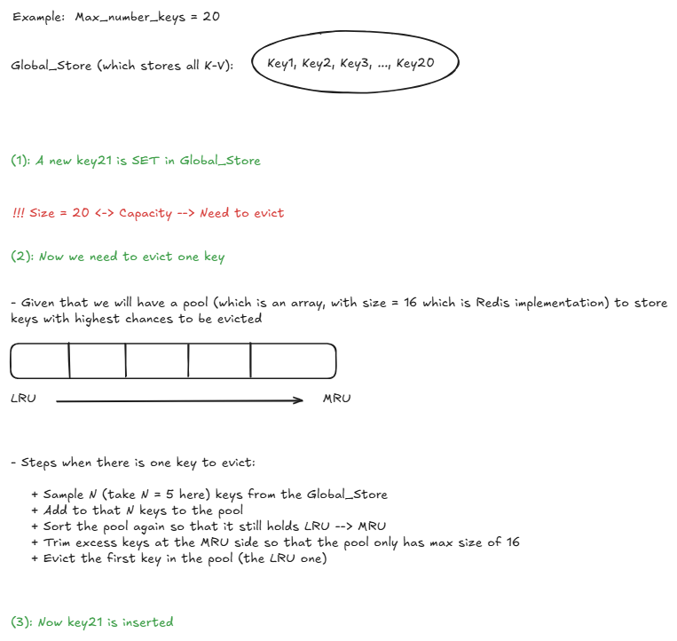

# Cache Eviction:

Reference:
https://redis.io/docs/latest/develop/reference/eviction/

- Cache eviction is the process of removing data from a cache to make room for new data when the cache reaches its capacity.

- By default, Redis's maxmemory for 32-bit systems is set to 3 GB, and for 64-bit systems, it is set to 4 GB. When the cache reaches its maximum memory limit, Redis will start evicting data based on the configured eviction policy.

- **However**, in Go, we can't hook the allocator. Redis wraps every malloc/free and keeps a running byte counter. Go’s runtime manages allocation itself, so there’s no place to intercept each allocation and count it. **Therefore, for the simplicity,** we will configute maximum number of keys, not maximum memory size.

Some of the common eviction policies in Redis:
https://redis.io/docs/latest/develop/reference/eviction/

- noeviction: No eviction, returns an error when the memory limit is reached.
- allkeys-lru: Evicts the least recently used keys out of all keys.
- allkeys-lfu: Evicts the least frequently used keys out of all keys.

...

# Random Eviction:

Evicts keys randomly. It is used when we expect all keys to be accessed with roughly equal frequency (But very hard in reality for this condition)

# LRU eviction:

- It is used when we expect some keys to be accessed more frequently than others. It evicts the least recently used keys first.

- We will use a Doubly Linked List to implement LRU eviction. The MRU keys will be at the tail of the list, and the LRU keys will be at the head of the list. When a key is accessed, it will be moved to the tail of the list. When we need to evict a key, we will remove the key at the head of the list.

- Do this leetcode question to fully understand: https://leetcode.com/problems/lru-cache/

# Approximated LRU eviction:

- Traditional LRU stores all keys in a Doubly Linked List, which can be memory intensive, space complexity O(n).

- How does approximated LRU work?

- ### Why this approach is nearly as good as LRU?

1. The pool accumulates candidates across evictions. Every eviction adds N new samples, and the pool keeps only the oldest keys it has seen. Over time, the evicted key is effectively chosen from many more than N samples.

2. Evicting a hot key requires every sample in the pool to be hot. One cold key among the samples is enough to save the hot ones. If 20% of keys are hot and N = 5, the chance of a bad eviction is at most 0.2⁵ ≈ 0.03%, and lower when the pool already holds cold candidates.

3. It doesn’t need to evict the oldest key, just a cold one. Evicting the 1st or the 50th oldest key out of a million makes almost no difference to hit rate.

- ### Limitations: pool entries can be stale. The pool stores each key’s access time at the moment it was sampled, and is not updated when the key is accessed later. Redis only checks that the key still exists before evicting it.

    Example: key A sits at the LRU end of the pool with lastAccessTime = 3. At t = 10, A is accessed again. On the next eviction, A is still evicted based on its outdated timestamp.

    Redis also doesn’t dedup samples. If A is resampled at t = 10, it enters the pool as a second entry, while the stale t = 3 entry still sits at the front and gets evicted.

    **!!!Fix**: 

    **1. Check at eviction time (covers all cases).**
    Before evicting the LRU-end entry, look up the key in the store and compare its current `lastAccessTime` with the one stored in the pool. If they differ, the key was accessed after it was sampled: drop the entry and try the next one. This costs one extra comparison, since the key must be looked up anyway to confirm it still exists.

    **2. Dedup at sampling time (covers resampled keys only).**
    When a sampled key is already in the pool, update the existing entry's `lastAccessTime` to the newer value instead of adding a duplicate. The sort-and-trim step then moves it to the right position, or drops it if it no longer qualifies. With fix 1 in place, this only stops duplicates from wasting pool slots and is not needed for correctness.
