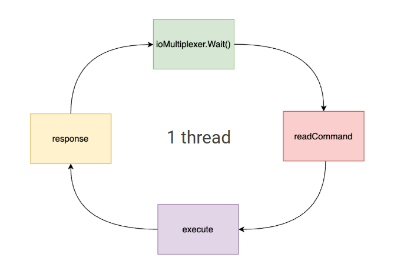
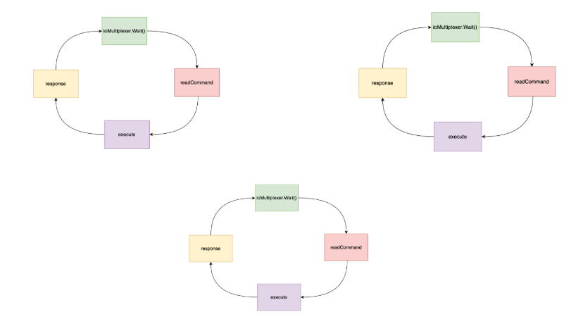
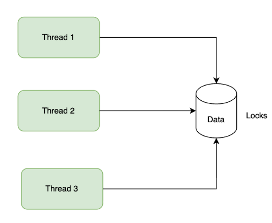
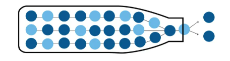
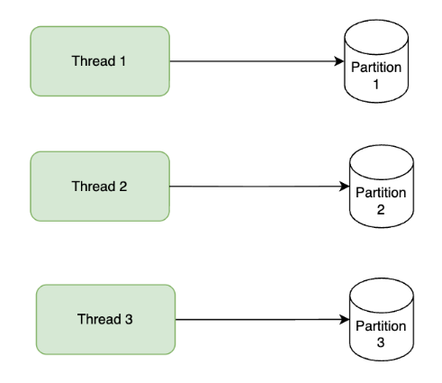
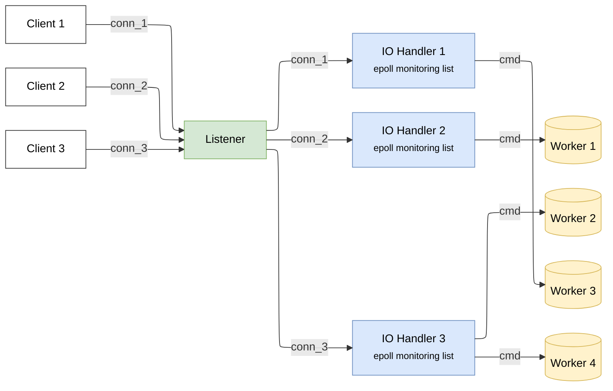
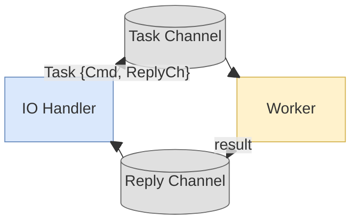

# Multi-thread Redis:


## 1. Review my current architecture so far

We use multiplexing to handle multiple connections in a single thread.



## 2. Idea for Multi-thread version

We can replicate the same architecture but with multiple threads



We have 2 models to handle concurrencyy:

1. **Shared-memory model**: All threads share the same memory space. This allows for easy communication between threads but it can lead to race conditions and requires careful synchronization.

    

    We can use mutex to lock the shared resources when a thread is accessing them. But this can lead to performance bottlenecks if many threads are trying to access the same resource at the same time.

    
    For example, if there are 3 threads trying to access the same resource, only one thread can access it at a time, while the other 2 threads have to wait, and CPU is still in used for context switching between threads, but the actual work is only done by one thread.


2. **Shared-nothing model**: Each thread has its own memory space and does not share data with other threads. This can lead to better performance as there is no contention for shared resources, but it can also lead to increased complexity in communication between threads.

    


**--> In this project, we will use the shared-nothing model. We accept the complexity to get better performance :)**


## 3. Our Shared-nothing architecture




The server uses **N I/O handler threads** and **M worker threads**. The two are sized independently, because network I/O and command execution need different amounts of resources and scale differently.

The keyspace is split into **M partitions**, one per worker. A worker can only access its own partition and knows nothing about the others. For example, with M = 3 and 10M keys, each worker owns roughly 3.3M keys. Which keys a worker owns is decided by `hash(key) % M`, so a partition is not a contiguous range of keys.

The architecture has three components:

### 1. Listener

A standard TCP listener that accepts new client connections. Each new connection is assigned to one of the N I/O handlers (round robin) and registered with that handler's `epoll` instance. For simplicity, we can use round-robin assignment.

### 2. I/O Handlers

Each I/O handler manages multiple connections through its own `epoll` loop. When a connection becomes readable, the handler:

1. Reads and parses the RESP request.
2. Extracts the key.
3. Routes the command to the owning worker using `hash(key) % M`.

Hashing gives two properties:
- **Determinism:** the same key always maps to the same worker. Every key has exactly one owner, so two threads never write to the same data, and no locks are needed.
- **Uniform distribution:** keys are spread evenly across workers, which keeps the load balanced.

Because of `% M`, M must stay fixed at startup. Changing M would remap almost every key.

**Special cases**:
- **Multi-key commands** (`DEL k1 k2`, `EXISTS k1 k2`): The command is split into multiple sub-commands, one per key, and each sub-command is sent to the owning worker. The I/O handler waits for all replies and combines them into a single reply to the client.
- **Keyless commands** (`PING`, `DBSIZE`, `FLUSHALL`): Just hand it off the a random I/O handler, i.e., using round robin.

### 3. Workers

Each worker owns one data partition and executes the commands it receives **sequentially**. Since a partition is only ever touched by its owning worker, command execution needs **no locks**. This is the core benefit of the shared-nothing design.

After executing a command, the worker sends the result back to the originating I/O handler, which writes the response to the client.


### 4. I/O to Worker Communication

I/O handlers and workers never share memory. They communicate only by passing messages over Go channels:

- **Task channel:** each worker owns one. It is the worker's only input, and every I/O handler sends commands for that worker into it.
- **Reply channel:** each I/O handler owns one. Every worker that executes a command on behalf of that handler sends the result back through it.

A unit of work is a `Task`, which bundles the command together with the channel the result should go back to:

```go
type Task struct {
    Cmd     *Command
    ReplyCh chan Reply
}
```

The flow for one command:

1. The I/O handler parses the request, picks the owning worker with `hash(key) % M`, and sends a `Task` into that worker's task channel.
2. The worker executes the command against its own store.
3. The worker sends the result into `task.ReplyCh`, which returns it to the I/O handler that sent the task.
4. The I/O handler writes the response back to the client.

Since the reply channel travels inside the task, a worker never needs to know which I/O handler sent the task. It just replies to whatever channel it was given.




