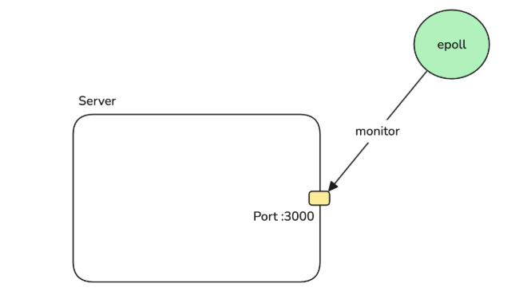
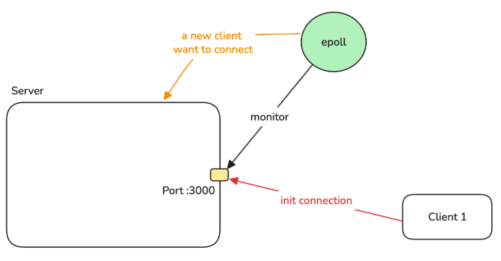
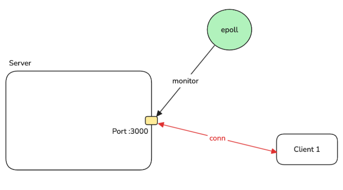
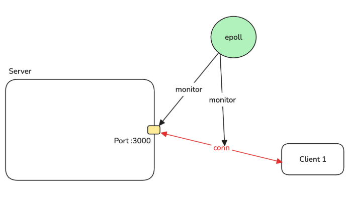
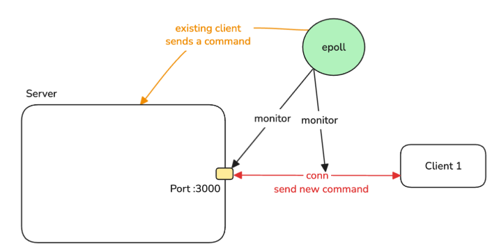

# 1 - Implement I/O Multiplexing

**Review concept:**

- Step 1: Create a Listener that listens to port 3000, then retreive its file descriptor (Why do we have to work with fd? Because later when we need the I/O multiplexer to monitor the fd, epoll/kqueue are OS-level syscalls — they work with file descriptors (integers). They don't know anything about Go's net.Listener, net.Conn, or any other high-level abstraction).

- Step 2: Create an epoll instance and let it monitor Listener's fd. (epoll is a Linux-specific I/O multiplexer, kqueue is the BSD/macOS equivalent).

- Step 3: There are two situation

1. A new client wants to make a TCP connection to server:
    - Epoll notifies server
    
    - Create a new connection
    
    - Let epoll monitor the new connection's fd
    
2. Existing client sends data to server:
    - Epoll notifies server
    
    - Read data from the connection, process command and response

# 2. RESP (Redis Serialization Protocol):

