# Refactor code:

Earlier versions kept a separate map per data structure (one for strings, one for sets, one for sorted sets). That doesn't scale: checking whether a key exists, or what type it holds, meant checking every store in turn, and that cost grows with every new data structure added. The current design uses one keyspace — a single map[string]*Object — where Object carries both a Kind tag and the underlying value. Existence and type checks become one map lookup no matter how many data structure types exist.

# Simple Set:

Very simple. In Go, we don't have Set data structure, so we use hashmap to implement it. The value of the map is a dummy struct{}{} because we don't care about the value, only the key.

**Commands implemented**: SADD, SREM, SISMEMBER, SMEMBERS

# Sorted Set:

A collection of unique strings (members) ordered by a score (float64).

Real Redis uses skiplist to implement sorted set, but we use B+ tree here.

Why? Let's talk about both

## 1. Skiplist:

- A probabilistic data structure that allows O(log n) search, insertion and deletion within an ordered sequence of elements.
- Cons: unstable runtime, high memory overhead

To better understand we take the analogy of the railway

Picture a railway line where each station is a member of the sorted set and its kilometre marker is the score:

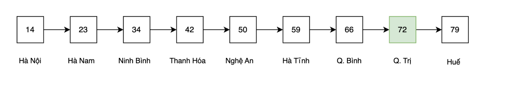

A **local train** (level 0) stops at every station. Finding Quảng Trị (km 72) by local train means passing through 7 stations first: O(n).

Now add **fast lines** above it. Each fast line stops at only some of the stations from the line below:
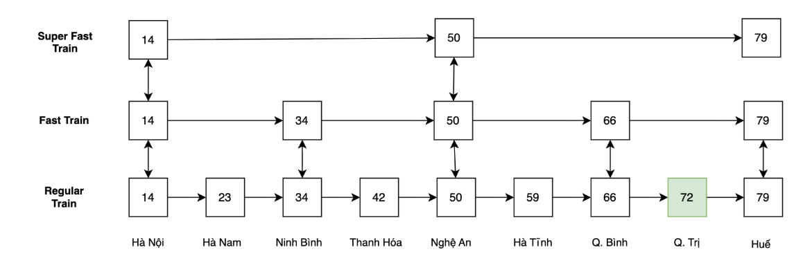

### Searching: ride the fastest line, step down when you would overshoot

To reach Quảng Trị (km 72):

1. **L2:** 14 → 50. The next stop is 79, past 72, so get off at 50 and switch down.
2. **L1:** 50 → 66. The next stop is 79, past 72, so switch down again.
3. **L0:** 66 → 72. Arrived.

Four hops instead of eight. Each level up skips more stations, so the search takes O(log n) on average.

### Inserting: which lines stop at the new station?

When a new station opens (say at km 62), it is always served by the local line. Then we flip a coin:

- Heads: the fast line above also stops here. Flip again for the next line up.
- Tails: stop. The station is served by every line so far, and none above.

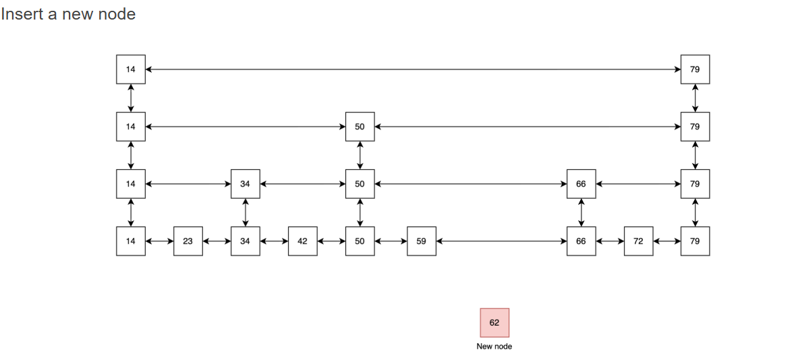

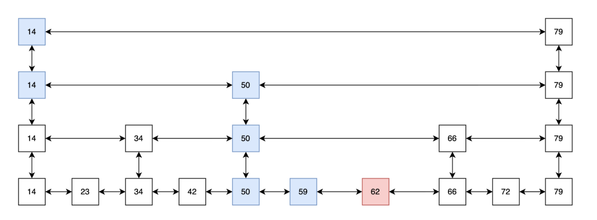

We flip coins to decide which fast lines stop at the new station. For example, HEAD is added to next level, TAIL is not

L1: HEAD
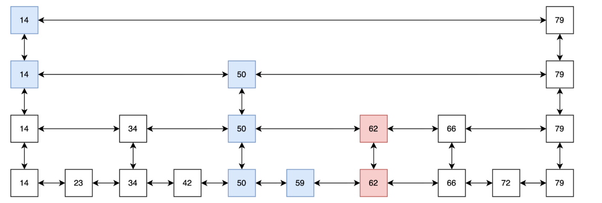

L2: HEAD

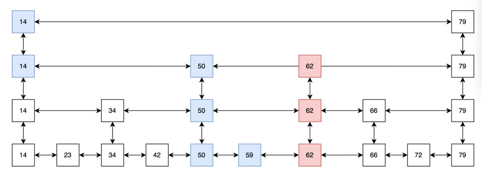

L3: TAIL --> Don't add to L3, stop flipping

Why a coin flip instead of carefully choosing fast stops? Because opening a station never forces us to re-plan the other stations. Insertion only touches the lines passing the new stop, with no rebalancing like a balanced tree would need.

**Redis skiplist's structure**:

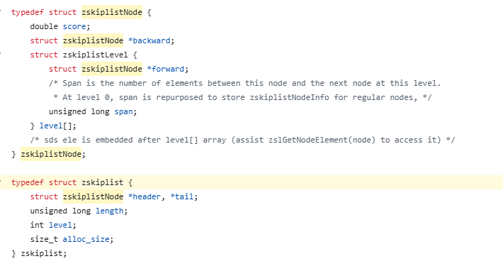

## 2. B+ Tree:

A B+ tree is a balanced search tree where each node holds **many keys** instead of one.

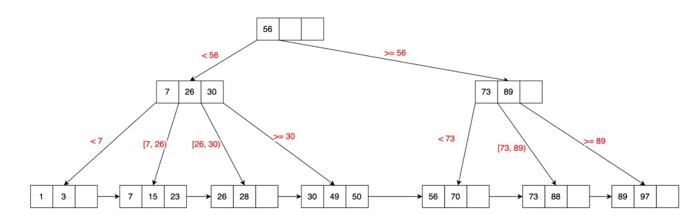

- **Internal nodes** store only routing keys and child pointers. They tell the search which branch to follow.
- **Leaves** store all the actual entries, in sorted order. All leaves sit at the same depth.
- **Leaves are linked**, so a range query finds its first entry, then walks sideways along the leaves.
- Each node has up to `m` children, so the tree height is about `log_m(n)`. With a large `m`, even millions of entries need only a few levels.

### Key ideas to keep in mind

- **Entries are ordered by `(score, member)`, not by score alone.** Many members can share the same score, so the member breaks ties and every entry gets a unique position. To find a member's rank, first look up its score in a separate hash map (`member → score`), then search the tree with the `(score, member)` pair.
- **Internal nodes only route; leaves hold the data.** Internal nodes contain separator keys that guide a search to the right leaf. Every actual entry lives at the leaf level, so every search ends at a leaf.
- **The tree grows upward, not downward.** In an ordinary binary search tree, new nodes are attached below existing leaves, so the tree grows at the bottom. In a B+ tree, a full node splits in two and pushes a separator key up to its parent. When the root itself splits, a new root is created above it, and that is the only time the height increases. As a result, all leaves always stay at the same depth.

### How to search in a B+ tree?

Just follow the routing internal nodes and when reach the leaf level, do a linear search for the key in the linked list. The search is O(logm n) because the tree height is O(logm n), where m is the maximum number of children per node. The linear search at the leaf level is O(m), but m is a constant, so the overall search time is still O(logm n).

### How to insert in a B+ tree?

Firstly, we still need to search for the key to find the leaf node where it should go. After finding the index to insert, we have some main cases:

1. **No overflow**:

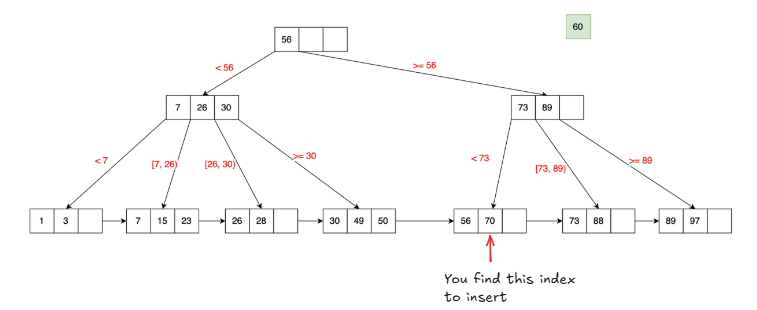

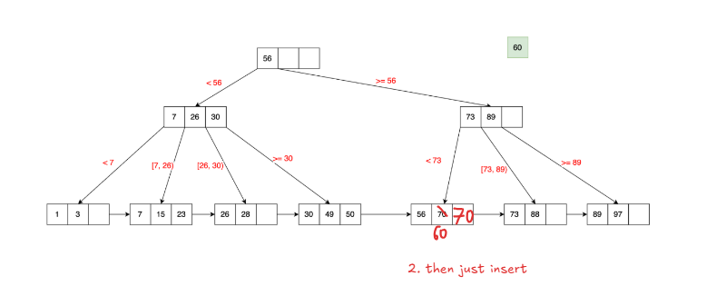

2. **Overflow**:

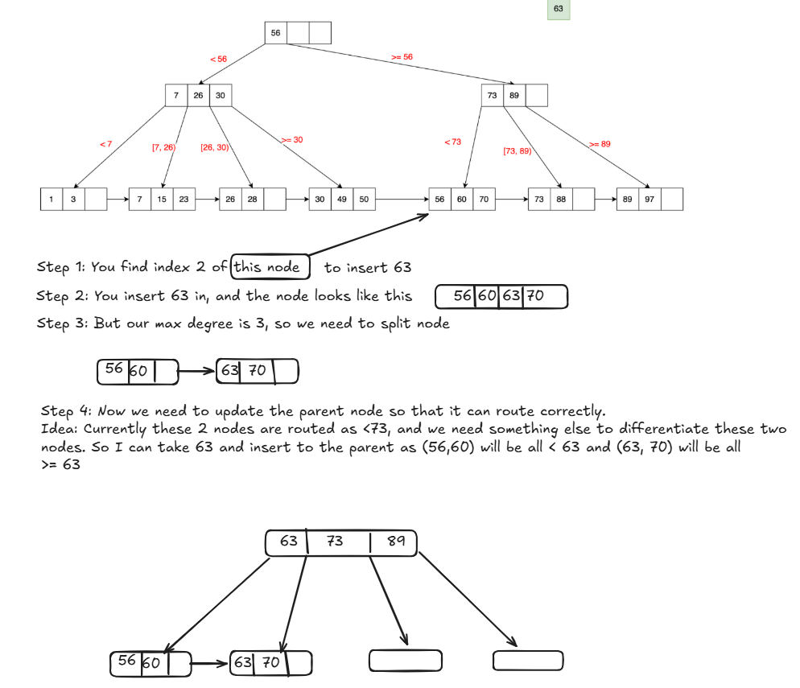

3. **Cascading Overflow**:

It's almost similar to the overflow case, but we need to split the parent node as well. This can happen recursively up to the root.

For example in the above example you add 61 (no overflow), then add 62 (overflow), then add 62 to parent (also overflow), then add 62 to grandparent (also overflow), then add 62 to root (also overflow). Finally, we create a new root and the tree height increases by 1.

### How to remove in a B+ tree?

Removal uses *lazy deletion*: the entry is deleted from its leaf, with no rebalancing afterwards.

**How it works**

1. `ZSet` looks up the member's score in its `member → score` hash map, since the tree is ordered by `(score, member)`.
2. `findLeaf(score, member)` descends from the root to the right leaf, the same way an insert does: O(log n).
3. The entry is removed from that leaf. No borrowing, no merging, no changes to internal nodes.

A score update is implemented as `remove(oldScore, member)` + `add(newScore, member)`.

This stays correct because internal nodes only hold routing keys, which remain valid boundaries even after their matching entry is deleted. No leaf is ever removed, so the leaf links never break.

**Limitations**

- Emptied leaves are never freed, and the tree never shrinks.
- The tree can become sparse, using more memory and causing more cache misses.
- If scores mostly move one way (e.g. leaderboard points that only increase), leaves on one side drain and are never refilled, while the other side keeps splitting.

**Why lazy deletion**

- **Simplicity:** full deletion must borrow from or merge with siblings, which can cascade up to the root.
- **If we have large degree:** the tree stays short, so sparse leaves add little search cost.

**Future improvements:** free leaves once they become empty, update scores in place when an entry's position doesn't change, or implement full borrow/merge rebalancing.

### How to rank scores in a B+ tree?

Rank uses the same descent as a normal search: follow the routing keys from the root down to the leaf where `(score, member)` lives. To get the rank along the way, every internal node stores a **count** for each child: the number of entries (stored in the leaves) inside that child's subtree.

On the way down, whenever we pass over children to the left of the one we enter, we add their counts to the rank. Every entry in those subtrees is smaller than the target, so we can count them without visiting them. At the leaf, we add the target's index within that leaf.

**Example** (degree 4): find the rank of `90`.

                            root
                      keys   [ 70 ]
                      counts [ 7 | 4 ]
                     /                \
             P1                                P2
     keys   [ 30 | 50 ]                keys   [ 90 ]
     counts [ 2  | 3  | 2 ]            counts [ 2 | 2 ]
        /       |        \                /       \
    [10 20] [30 40 45] [50 60]        [70 80]   [90 100]

| Step | Node | What happens | rank |
|---|---|---|---|
| 1 | root | `90 ≥ 70`: skip the whole P1 subtree, add its count `7` | 7 |
| 2 | P2 | `90 ≥ 90`: skip leaf `[70 80]`, add its count `2` | 9 |
| 3 | leaf `[90 100]` | `90` is at index `0`, add `0` | **9** |

Check: `10 20 30 40 45 50 60 70 80 90 …`, and `90` is at position 9. The search reads two counts instead of walking past nine entries, so rank is O(log n).

**Keeping counts correct:** `add` and `remove` adjust the counts by +1 / −1 on every ancestor of the changed leaf, and a split recomputes the counts of the two nodes it produces.