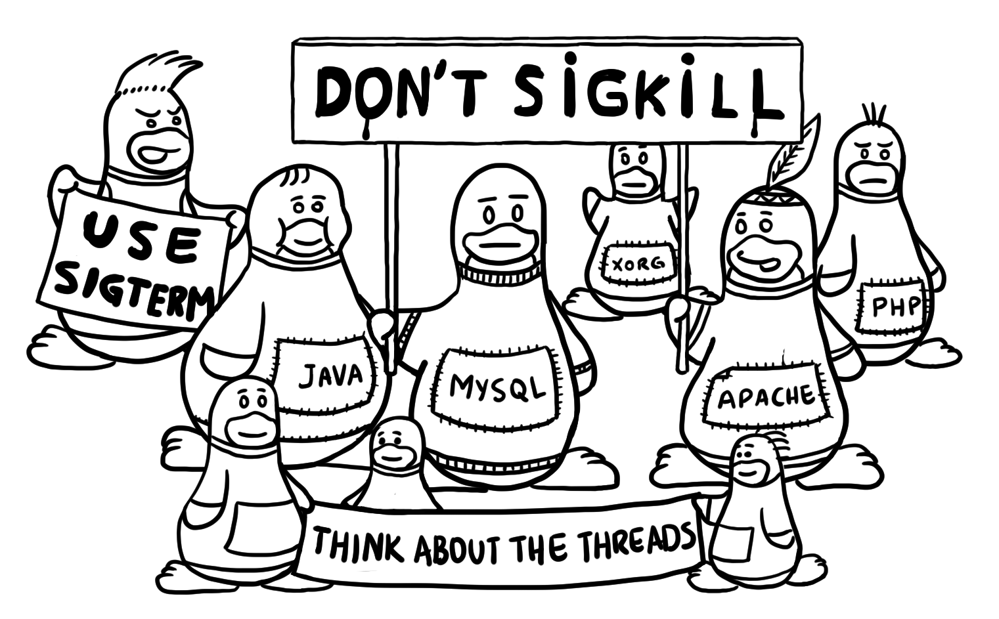
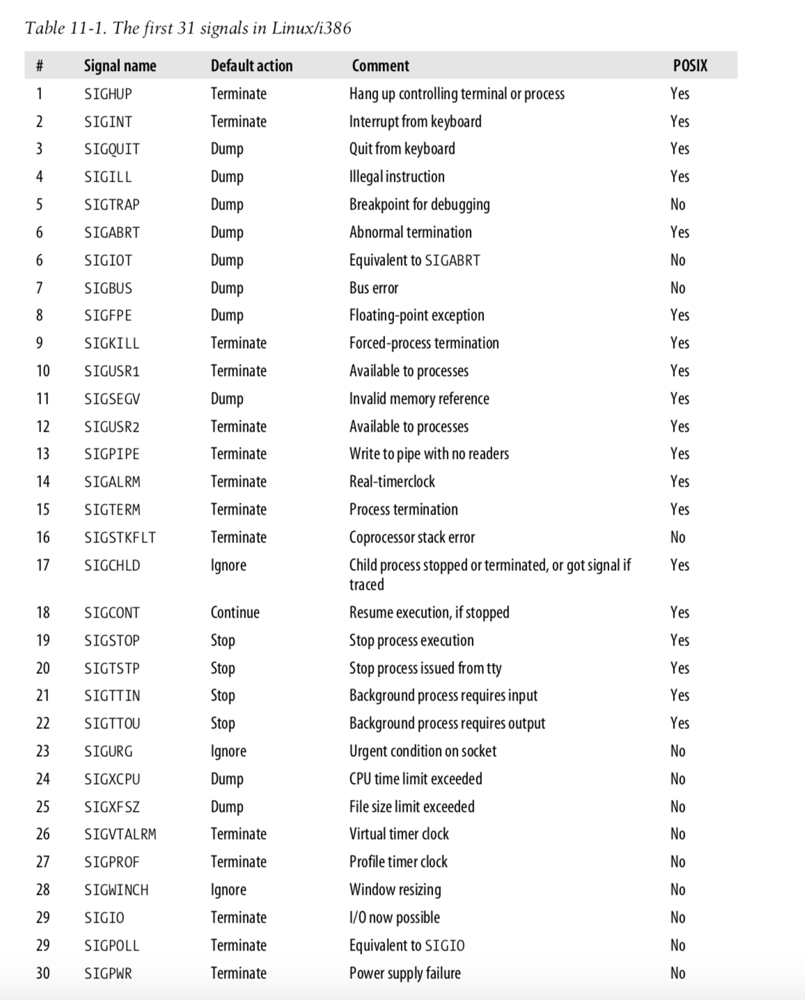
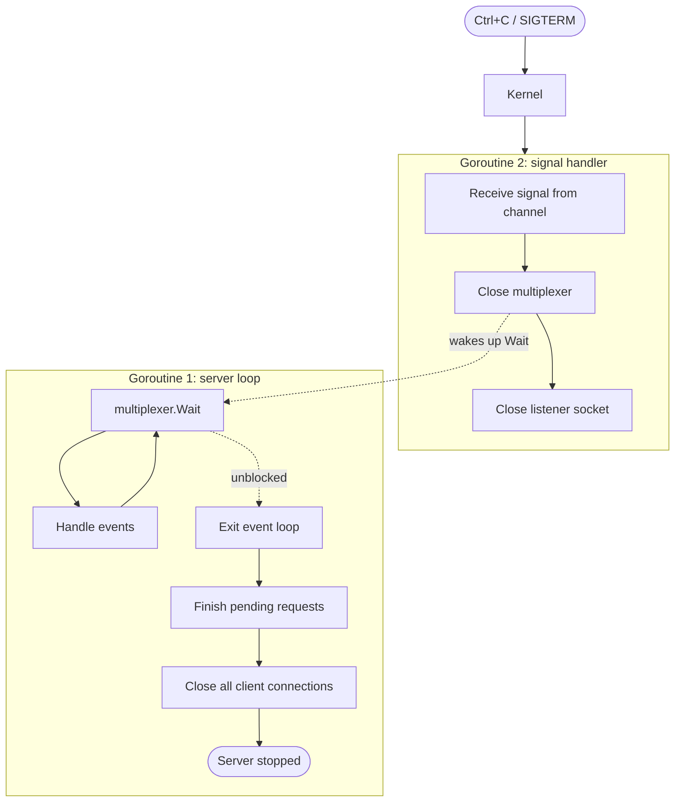

# Graceful Shutdown

A graceful shutdown is a controlled sequence of actions that a running application takes to terminate its operations cleanly and safely.

# Why do we need graceful shutdown?

For a few common reasons:

1. **Prevent data loss/corruption**:
- Rollback database transactions, close file handles, and ensure that all in-memory data is persisted to disk before shutting down.
- Save logs
- Wait for ongoing requests to complete
- ...

2. **Release Resouces**:
E.g., release locks, close network connections, and free up memory to avoid resource leaks.

3. **Client Notification**

# We need to understand what is signal first?

### 1. What is a signal?
A signal is an asynchronois notification sent to a process or thread to indicate a specific event or condition. These signals can be generated by the operating system, other processes, or even the process itself.

### 2. How is a signal handled?

- Each signal has an associated default action that is executed if the process does not have a custom signal handler. However, these default actions can vary depending on the operating system.

    

- We can create custom signal handlers to override the default actions, such as cleaning up resources, logging information, or gracefully shutting down the application.
- In some special cases, **there are signals that cannot be caught or ignored**, such as SIGKILL and SIGSTOP. These signals are used to **forcefully terminate or pause a process**, and the operating system does not allow the process to handle them.

Reference docs about Signal: https://medium.com/@4990/signals-in-operating-systems-7c7b90523b61

# The Core Idea:

