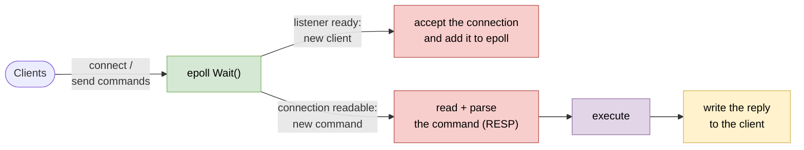
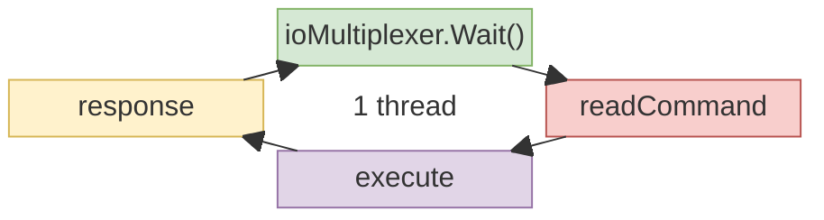
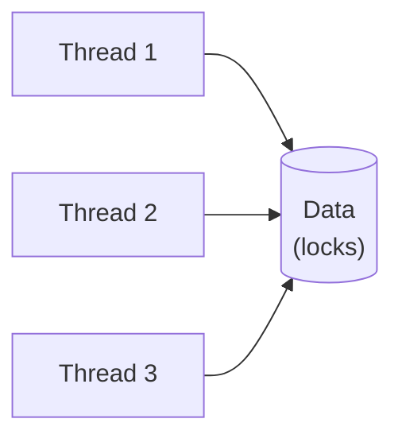
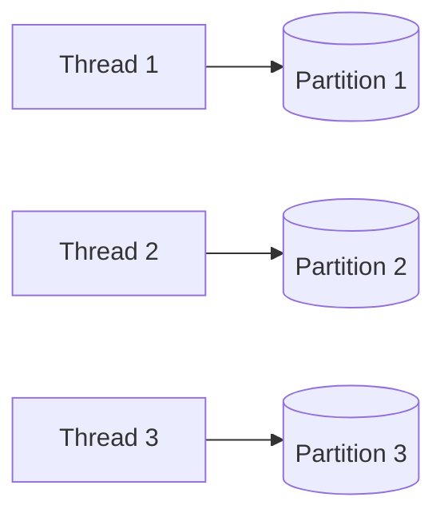
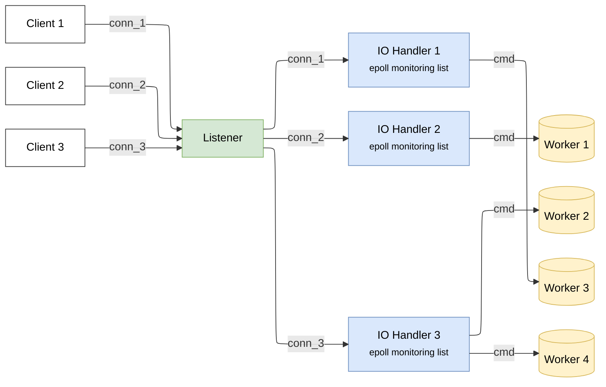

# Building single-thread and multithreaded Redis server from scratch in Go

I first built a single-thread Redis server whose I/O model is **I/O multiplexing** (`epoll`), the same model real Redis uses. A server like this is I/O-bound: most of its time goes into reading from and writing to sockets. That made me curious what happens if I add more threads to the I/O layer, so I built **both versions**. You pick one when the server starts.

Both speak RESP, the Redis protocol, so `redis-cli` and `redis-benchmark` work against them unchanged.

## A. What I built

| Area | Implemented |
|---|---|
| Basic commands | `PING`, `SET` (with `EX`), `GET`, `DEL`, `EXISTS`, `TTL`, `PTTL`, `EXPIRE` |
| Simple set | `SADD`, `SREM`, `SISMEMBER`, `SMEMBERS` |
| Sorted set (B+ tree) | `ZADD`, `ZREM`, `ZSCORE`, `ZRANK` |
| Count-min Sketch | `CMS.INITBYDIM`, `CMS.INITBYPROB`, `CMS.INCRBY`, `CMS.QUERY`, `CMS.INFO` |
| Bloom filter | `BF.RESERVE`, `BF.ADD`, `BF.MADD`, `BF.EXISTS`, `BF.MEXISTS`, `BF.INFO` |
| Key expiry | Lazy + active deletion |
| Cache eviction | Random, LRU (all keys), approximated LRU |
| Graceful shutdown | Handle SIGINT / SIGTERM |
| Server engines | Single-thread, multithread |

## B. Architecture

### 1. Single-thread



One thread does everything. `epoll` watches the listener and every client connection, and `Wait()` blocks until one of them is ready:
- The listener is ready: a new client is connecting. Accept it and add the connection to `epoll`'s watch list.
- A connection is readable: a command has arrived. Read and parse it, execute it, write the reply, and go back to `Wait()`.

`Wait()` also has a timeout, so the loop wakes up regularly to delete expired keys even when no client is active.

So the whole server is one loop:



### 2. Multithreaded

One loop can only use one CPU core. Since the work is mostly I/O, I added more threads to the I/O layer: copy the single-thread loop several times, so many clients are served in parallel. The open question is what to do with the data. There are two models:

#### a. Shared-memory



All threads read and write the same data, so every access needs a lock (a mutex). Only one thread can hold the lock at a time, and the others wait. With 3 threads, the CPU keeps switching between them, but only one is doing real work at any moment. Adding threads doesn't make data access faster; it just adds waiting and context switching.

#### b. Shared-nothing



Each thread owns one partition of the data and never touches the others, so there are no locks and no thread waits for another. The price is complexity: every command must be sent to the thread that owns its key, and commands that touch several keys need extra work.

**This project uses shared-nothing.** I accept the extra complexity to get real parallelism.

#### The multithreaded architecture



- **Listener:** accepts new connections and hands each one to an IO handler, round robin.
- **IO handlers:** each runs its own `epoll` loop over its connections. It reads and parses commands, sends each one to the worker that owns its key (`hash(key) % M`), and writes the reply back to the client.
- **Workers:** each owns one partition: its own keyspace, expiry and eviction state, so it needs no locks. It executes its commands one at a time and also deletes expired keys in its partition.
- **Channels:** IO handlers and workers only talk through Go channels. Each worker has a task channel, and each IO handler has a reply channel. A task carries the command plus the reply channel to answer on.
- **Special cases:** a multi-key `DEL` / `EXISTS` is split per worker and the counts are added up. Keyless commands such as `PING` go to any worker.

More details are in [Documentation/9-Multithread_Redis](Documentation/9-Multithread_Redis/README.md).

## C. Project layout

```
Redis-k02/
├── main.go                   # entry point: asks for single-thread or multithread, then starts it
├── internal/
│   ├── resp/                 # RESP parser and encoder
│   ├── command/              # command handlers: strings, keys, set, sorted set, CMS, Bloom filter
│   ├── core/                 # Store: keyspace, expiry, eviction (one per engine / per worker)
│   ├── datastructure/        # simple set, B+ tree sorted set, CMS, Bloom filter, LRU list, eviction pool
│   ├── config/               # every tunable number in one place
│   └── server/               # shared plumbing: listener, per-connection read -> parse -> reply
│       ├── single_thread/    # the event-loop engine
│       └── multithread/      # listener + IO handlers + workers
├── io_multiplexing/          # i/o multiplexing wrapper
├── benchmark/                # run.sh + result.md (server); eviction/ + eviction_result.md (eviction policies)
├── Documentation/            # my notes for every part, 1 to 9
├── go.mod
└── README.md
```

## D. Getting started

I only implemented the I/O multiplexer with `epoll`, so the server currently runs on **Linux**. 

```bash
go run .
# Choose the server version:
#   1) Single-thread
#   2) Multi-thread
```

Then, from another terminal:

```bash
redis-cli -p 4000
127.0.0.1:4000> SET hello world EX 60
OK
127.0.0.1:4000> GET hello
"world"
```

## E. Benchmark

### 1. Single-thread vs multithread

`redis-benchmark` on a laptop: Intel i5-1135G7 (4 cores / 8 threads), WSL2. The comparison is single-thread vs multithread. Real Redis 7.0.15 is only a reference point for checking the setup, so it doesn't count toward the winner.

+) **Throughput (requests/sec, higher is better)**

| Test | Single-thread | Multithread | Real Redis (reference) | Winner |
|---|---:|---:|---:|---|
| 1 client (SET / GET) | 12.6k / 15.8k | 15.3k / 10.9k | 16k / 17k | Even |
| 50 clients (SET / GET) | 143k / 125k | 56k / 54k | 194k / 140k | Single-thread |
| 200 clients, 4 client threads (SET / GET) | 55k / 42k | 68k / 82k | 120k / 61k | Multithread |
| Hot key, all clients on 1 key (SET / GET) | 56k / 35k | 50k / 45k | 56k / 55k | Even |
| Pipelining, `-P 16` (SET / GET) | 19k / 18k | 18k / 18k | 98k / 198k | Even |
| Heavy command on ~400-member sets (SMEMBERS) | 3.6k | 5.4k | 4.3k | Multithread |

+) **Latency (p50 in ms, lower is better)**

| Test | Single-thread | Multithread | Real Redis (reference) | Winner |
|---|---:|---:|---:|---|
| 1 client (SET / GET) | 0.063 / 0.055 | 0.071 / 0.079 | 0.055 / 0.055 | Single-thread |
| 50 clients (SET / GET) | 0.183 / 0.191 | 0.495 / 0.479 | 0.183 / 0.175 | Single-thread |
| 200 clients, 4 client threads (SET / GET) | 3.295 / 3.439 | 1.199 / 1.231 | 1.831 / 2.679 | Multithread |
| Hot key, all clients on 1 key (SET / GET) | 2.535 / 3.199 | 1.199 / 1.367 | 2.607 / 2.703 | Multithread |
| Pipelining, `-P 16` (SET / GET) | n/a | n/a | n/a | n/a |
| Heavy command on ~400-member sets (SMEMBERS) | 55.967 | 36.127 | 44.767 | Multithread |

Pipelining latency is left out because redis-benchmark only times each 16-command batch until its first reply, so those numbers don't mean much.

- **Single-thread wins under light load (1–50 clients).** Each command is handled start to finish on one thread, while multithread pays for two hand-offs between threads per command. So single-thread has the lower latency, and at 50 clients much higher throughput.
- **Multithread wins with many concurrent clients and CPU-heavy commands.** Reading, parsing and executing are spread across CPU cores, so it wins on both throughput and latency.
- **Throughput is even with a hot key and with pipelining.** With a hot key every command goes to the same worker; with pipelining both engines are limited by the same reply-writing code. With a hot key, multithread still has the lower latency, because reading and parsing stay parallel across IO handlers.

This is one run on a laptop, so the numbers are noisy. The full tables with latencies, and how to rerun them, are in [benchmark/result.md](benchmark/result.md).

### 2. Cache eviction policies

The cache holds a fixed number of keys. Requests follow a Zipfian distribution (alpha = 0.99) over 1,000,000 keys: a few keys get most of the requests, like real cache traffic. Each request GETs a key, and on a miss SETs it. The benchmark calls the keyspace (`core.Store`) directly, so it measures only the eviction policy, not the network. Every policy replays the same 7,000,000-request trace, and the first 2,000,000 requests only warm the cache up.

+) **Hit ratio (higher is better)**

| Cache size (% of keys) | Random | LRU | Approx LRU |
|---|---:|---:|---:|
| 1% | 51.10% | 56.65% | 56.45% |
| 5% | 65.32% | 70.38% | 70.18% |
| 10% | 71.95% | 76.66% | 76.46% |
| 25% | 81.85% | 85.48% | 85.30% |

+) **Memory per key (lower is better):** LRU 175.5 bytes, approx LRU 87.8 bytes, random 87.8 bytes.

- **Approx LRU is within 0.2 pp of exact LRU at every cache size, with half the memory per key.** Exact LRU keeps a linked list node and an index map entry for every key. Approx LRU only keeps an 8-byte access stamp per key, plus one pool of 16 candidates.
- **Both LRU variants beat random eviction by 3.5 to 5.6 pp, i.e. 11% to 20% fewer misses.** The pp gain is largest with a small cache. The relative cut in misses is largest with a big one.
- With uniform traffic, every policy gets cache size / keyspace, as it should. This checks the benchmark itself.

The full tables are in [benchmark/eviction_result.md](benchmark/eviction_result.md). They also cover the uniform workload and the hit ratio of an ideal cache that always holds the hottest keys. To rerun (any OS, about 8 minutes): `go run ./benchmark/eviction`.

## F. The journey

Each part's code is on its own branch, and its notes are in [Documentation/](Documentation).

| Part | Topic | Covers | Branch | Notes |
|---|---|---|---|---|
| 1 | Redis introduction | Processes, threads, goroutines; server models | [branch](https://github.com/TimSing6584/Multithread-Redis/tree/Part1-Redis_Introduction) | [notes](Documentation/1-Redis_Introduction/README.md) |
| 2 | TCP server | TCP server, thread pool, file descriptors, I/O models | [branch](https://github.com/TimSing6584/Multithread-Redis/tree/Part2-TCP_Server) | [notes](Documentation/2-TCP_Server/README.md) |
| 3 | I/O multiplexing + RESP | `epoll` event loop, RESP parser | [branch](https://github.com/TimSing6584/Multithread-Redis/tree/Part3-IO_Multiplexing_RESP) | [notes](Documentation/3-IO_Multiplexing_RESP/README.md) |
| 4 | Basic commands | `PING`, `SET`, `GET`, `TTL`, `EXPIRE`, `DEL`, `EXISTS`; key expiry | [branch](https://github.com/TimSing6584/Multithread-Redis/tree/Part4-Basic_Commands) | [notes](Documentation/4-Basic_Commands/README.md) |
| 5 | Set and sorted set | Simple set; sorted set on a B+ tree | [branch](https://github.com/TimSing6584/Multithread-Redis/tree/Part5-Set_SortedSet) | [notes](Documentation/5-Set_SortedSet/README.md) |
| 6 | Count-min Sketch and Bloom filter | Probabilistic data structures and their commands | [branch](https://github.com/TimSing6584/Multithread-Redis/tree/Part6-CMS_BloomFilter) | [notes](Documentation/6-CMS_BloomFilter/README.md) |
| 7 | Cache eviction | Random, LRU, approximated LRU | [branch](https://github.com/TimSing6584/Multithread-Redis/tree/Part7-Cache_Eviction) | [notes](Documentation/7-Cache_Eviction/README.md) |
| 8 | Graceful shutdown | Signals; shutting down cleanly | [branch](https://github.com/TimSing6584/Multithread-Redis/tree/Part8-Graceful_Shutdown) | [notes](Documentation/8-Graceful_Shutdown/README.md) |
| 9 | Multithread Redis | Shared-nothing architecture; benchmarks | [branch](https://github.com/TimSing6584/Multithread-Redis/tree/Part9-Multithread_Redis) | [notes](Documentation/9-Multithread_Redis/README.md) |

## G. What's next

- Persistence with RDB snapshots: right now all data lives in memory and is lost when the server stops. Periodically saving a snapshot to disk, and loading it on startup, would fix that.
- Faster pipelining: write all the replies from one read in a single `write` (and set `TCP_NODELAY`), instead of one `write` per reply.
- Authentication: right now anyone can connect and do anything. Add a password and check it before executing commands.

    ...
