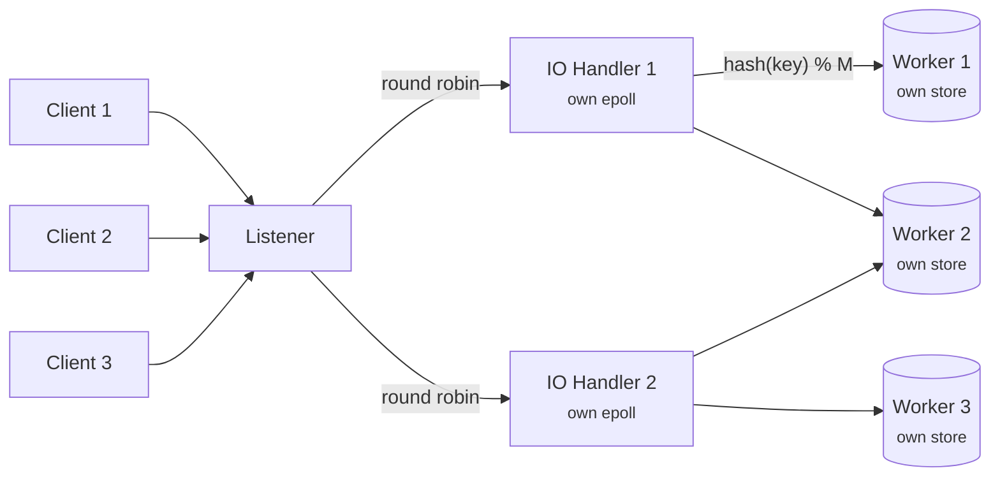

# Redis-k02

A Redis server built from scratch in Go, one concept at a time. It started as a plain TCP server and ended as a **shared-nothing multithreaded** engine.

It speaks RESP, the real Redis protocol, so `redis-cli` and `redis-benchmark` work against it with no changes. This README describes the latest version. Every earlier step is kept on its own branch (see [The journey](#the-journey)).

## What it does

| Area | What is implemented |
|---|---|
| Protocol | RESP parser that copes with partial reads and pipelined commands |
| Strings and keys | `PING`, `SET` (with `EX`), `GET`, `DEL`, `EXISTS` |
| Expiry | `TTL`, `PTTL`, `EXPIRE`. Expired keys are deleted lazily (on access) and actively (a periodic sampling sweep with a time budget) |
| Set | `SADD`, `SREM`, `SISMEMBER`, `SMEMBERS` |
| Sorted set | `ZADD`, `ZREM`, `ZSCORE`, `ZRANK`, backed by a B+ tree with O(log n) rank |
| Count-min Sketch | `CMS.INITBYDIM`, `CMS.INITBYPROB`, `CMS.INCRBY`, `CMS.QUERY`, `CMS.INFO` |
| Bloom filter | `BF.RESERVE`, `BF.ADD`, `BF.MADD`, `BF.EXISTS`, `BF.MEXISTS`, `BF.INFO` |
| Eviction | Random, LRU, or approximated LRU (Redis-style sampling with an eviction pool) once `MaxKeys` is reached |
| Shutdown | Graceful on SIGINT/SIGTERM: stop accepting, close every connection, then exit |
| Engines | **Single-thread** or **multithread**, chosen when the server starts |

## Architecture

### Single-thread engine

One goroutine runs an event loop on top of `epoll`. The OS reports which connections are readable. The loop reads them, parses the commands, runs them against the one keyspace and writes the replies. `Wait()` has a timeout, so even when no client is active the loop wakes up regularly to run the active-expiry sweep.

### Multithread engine (shared-nothing)



- **Listener (1):** accepts connections and hands each one to an IO handler, round robin.
- **IO handlers (N):** each runs its own `epoll` loop over its connections. It reads and parses a command, picks the owning worker with `hash(key) % M`, waits for that worker's reply and writes it to the client. One connection is handled one command at a time, so pipelined replies come back in order.
- **Workers (M):** each owns one partition of the keyspace: its own store, expiry table and eviction state, so **no locks** are needed. A worker runs its commands one after another and does active expiry on a ticker.
- **Communication:** only Go channels, never shared memory. Each worker has a **task channel** and each IO handler a **reply channel**. A task carries the command plus the reply channel the result goes back on, so a worker never needs to know who sent it.
- **Special cases:** `DEL` and `EXISTS` with several keys are split into one sub-command per owning worker, and the integer replies are summed (this isn't atomic across workers). Keyless commands such as `PING` go to any worker, round robin.
- **Sizing:** N and M are set separately (by default each is half the CPU count). `MaxKeys` is split evenly across the workers.

The reasoning behind this design (shared-memory vs shared-nothing) is in [Documentation/9-Multithread_Redis](Documentation/9-Multithread_Redis/README.md).

## Project layout

```
main.go                 entry point: asks for single-thread or multithread, then starts it
internal/
  resp/                 RESP parser and encoder
  command/              command handlers: strings, keys, set, sorted set, CMS, Bloom filter
  core/                 Store: keyspace, expiry, eviction (one per engine / per worker)
  datastructure/        simple set, B+ tree sorted set, CMS, Bloom filter, LRU list, eviction pool
  config/               every tunable number in one place
  server/               shared plumbing: listener, per-connection read -> parse -> reply
    single_thread/      the event-loop engine
    multithread/        listener + IO handlers + workers
io_multiplexing/        epoll wrapper
benchmark/              run.sh and its latest result.md
Documentation/          my notes for every part, 1 to 9
```

## Getting started

The server uses `epoll`, so it runs on **Linux only**. On Windows, run it inside WSL.

```bash
go run .
# Choose the server version:
#   1) Single-thread
#   2) Multi-thread
```

Then, from another terminal:

```bash
redis-cli -p 4000
127.0.0.1:4000> SET hello world EX 60
OK
127.0.0.1:4000> GET hello
"world"
```

## Benchmark

`redis-benchmark` against real Redis 7.0.15 and both engines, on a laptop: Intel i5-1135G7 (4 cores / 8 threads) running WSL2. The numbers are requests/sec, written SET / GET.

| Test | Real Redis | Single-thread | Multithread | Winner |
|---|---:|---:|---:|---|
| 1 client (latency) | 16k / 17k | 12.6k / 15.8k | 15.3k / 10.9k | Real ≈ Single |
| 50 clients | 194k / 140k | 143k / 125k | 56k / 54k | Real |
| 200 clients, 4 client threads | 120k / 61k | 55k / 42k | 68k / 82k | Mixed |
| Hot key (all clients on 1 key) | 56k / 55k | 56k / 35k | 50k / 45k | Real ≈ Single |
| Pipelining (`-P 16`) | 98k / 198k | 19k / 18k | 18k / 18k | Real |
| SMEMBERS on ~400-member sets | 4.3k | 3.6k | 5.4k | Multithread |

What this shows:
- **Single-thread** gets close to real Redis on plain request/reply traffic.
- **Multithread** pays for two channel handoffs on every command. It only pays off with many concurrent clients or CPU-heavy commands. With a hot key, all the work lands on one worker.
- **Pipelining** is the biggest gap. Each reply goes out in its own `write`, and without `TCP_NODELAY`, Nagle's algorithm holds the small writes back. Real Redis writes a whole batch of replies at once.
- This is a single run on a laptop, so it's noisy. The full tables with latencies, and how each test was run, are in [benchmark/result.md](benchmark/result.md). To rerun: `bash benchmark/run.sh` inside WSL (about 10 minutes, ports 4000 and 5000 must be free).

## The journey

Each part's code is on its own branch, and its notes are in [Documentation/](Documentation).

| Part | Topic | What I built and learned | Code | Notes |
|---|---|---|---|---|
| 1 | Redis introduction | What Redis is; programs vs processes vs OS threads vs goroutines; thread-per-connection, thread pool and event-driven server models; a mutex-protected counter | [branch](https://github.com/TimSing6584/Multithread-Redis/tree/Part1-Redis_Introduction) | [notes](Documentation/1-Redis_Introduction/README.md) |
| 2 | TCP server | A TCP server, client and thread pool in Go; "everything is a file" and file descriptors; the I/O models (blocking, non-blocking, asynchronous, multiplexing) | [branch](https://github.com/TimSing6584/Multithread-Redis/tree/Part2-TCP_Server) | [notes](Documentation/2-TCP_Server/README.md) |
| 3 | I/O multiplexing + RESP | A single-threaded server on `epoll`; a parser for RESP, the Redis protocol | [branch](https://github.com/TimSing6584/Multithread-Redis/tree/Part3-IO_Multiplexing_RESP) | [notes](Documentation/3-IO_Multiplexing_RESP/README.md) |
| 4 | Basic commands | `PING`, `SET`, `GET`, `TTL`, `EXPIRE`, `DEL`, `EXISTS`; buffering partial commands per connection; lazy + active expiry with a sampling threshold and a time budget | [branch](https://github.com/TimSing6584/Multithread-Redis/tree/Part4-Basic_Commands) | [notes](Documentation/4-Basic_Commands/README.md) |
| 5 | Set and sorted set | Set commands; a sorted set on a B+ tree instead of Redis's skiplist, with O(log n) rank using subtree counts | [branch](https://github.com/TimSing6584/Multithread-Redis/tree/Part5-Set_SortedSet) | [notes](Documentation/5-Set_SortedSet/README.md) |
| 6 | Count-min Sketch and Bloom filter | Probabilistic data structures: counting and membership in a fixed amount of memory, sizing from error rates, double hashing, bit arrays | [branch](https://github.com/TimSing6584/Multithread-Redis/tree/Part6-CMS_BloomFilter) | [notes](Documentation/6-CMS_BloomFilter/README.md) |
| 7 | Cache eviction | Random, exact LRU (map + doubly linked list), and Redis's approximated LRU (sampling + eviction pool) and its trade-offs | [branch](https://github.com/TimSing6584/Multithread-Redis/tree/Part7-Cache_Eviction) | [notes](Documentation/7-Cache_Eviction/README.md) |
| 8 | Graceful shutdown | What signals are and how they're handled; stopping the event loop and closing every connection before exit | [branch](https://github.com/TimSing6584/Multithread-Redis/tree/Part8-Graceful_Shutdown) | [notes](Documentation/8-Graceful_Shutdown/README.md) |
| 9 | Multithread Redis | Shared-memory vs shared-nothing; refactoring global state into a per-worker `Store`; listener, IO handlers, workers, channels; benchmarking against real Redis | [branch](https://github.com/TimSing6584/Multithread-Redis/tree/Part9-Multithread_Redis) | [notes](Documentation/9-Multithread_Redis/README.md) |

## What's next

- Write all replies from one read in a single `write` (and/or set `TCP_NODELAY`) to close the pipelining gap.
- Let an IO handler keep several commands in flight instead of waiting for each reply, so the cost of the channel handoff is overlapped.
